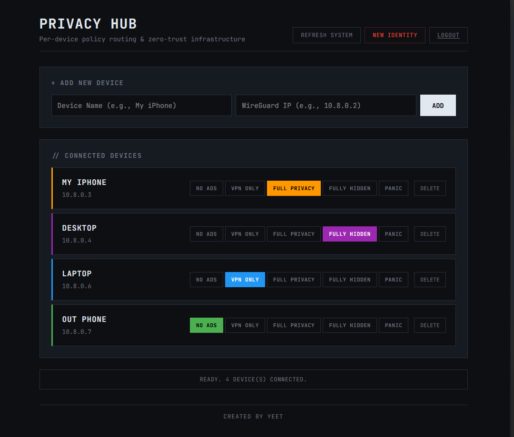
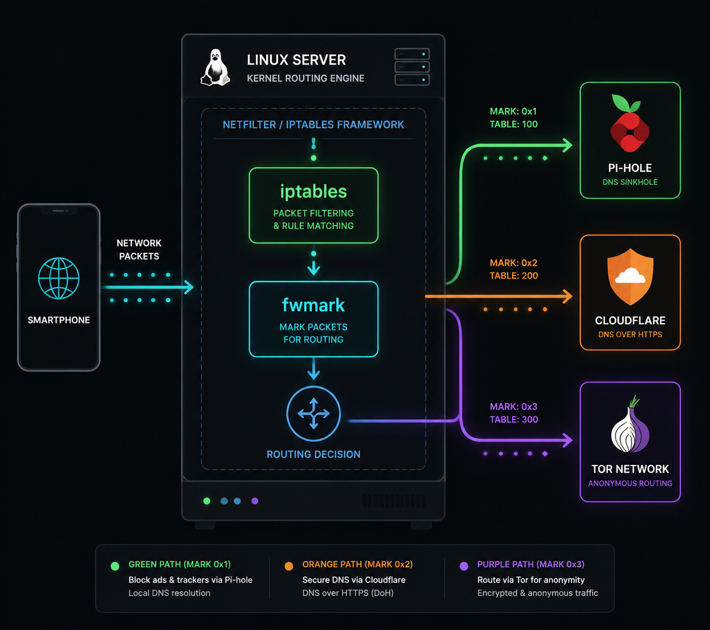
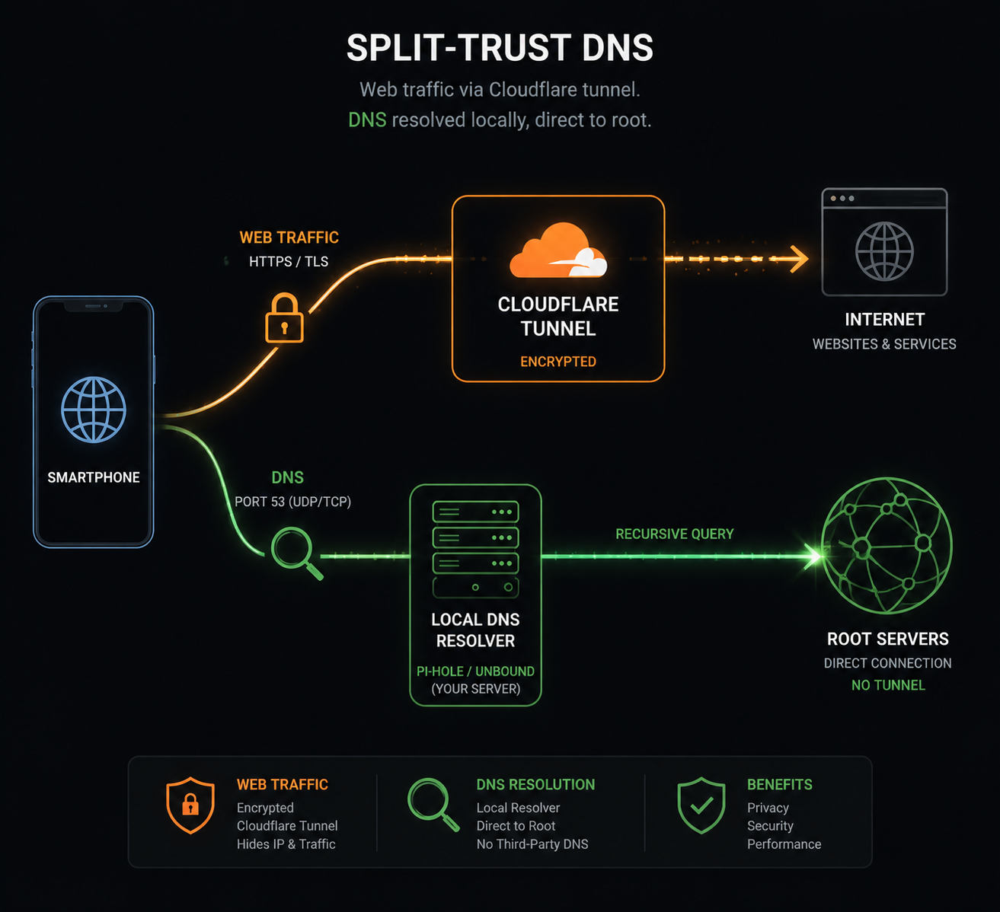
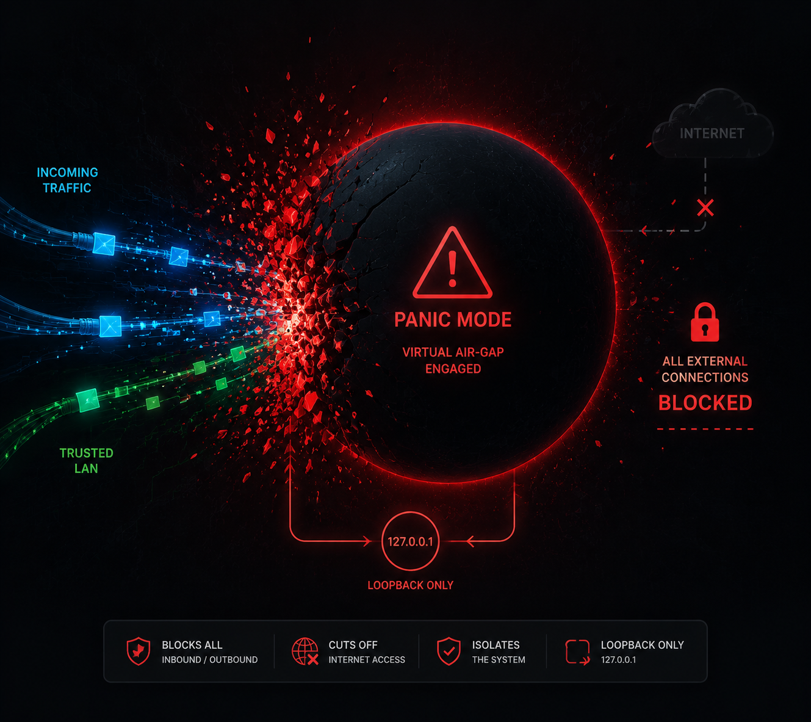
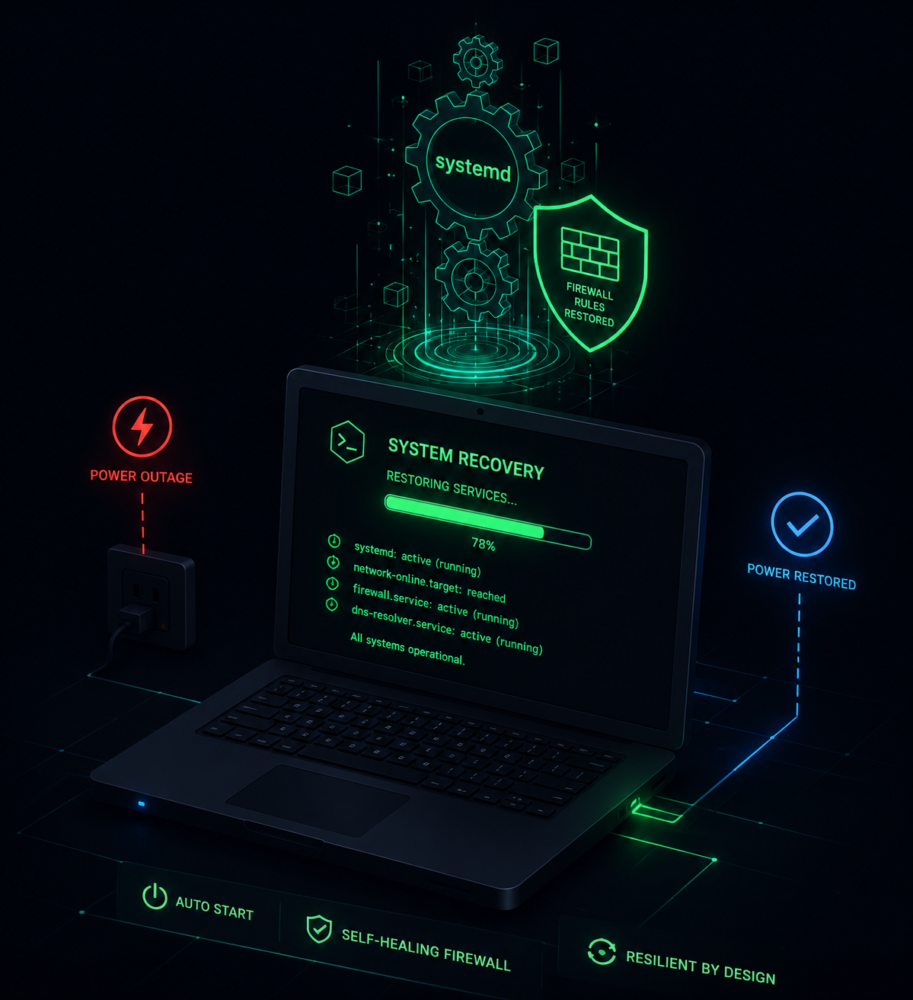

[]()
[]()
[]()
[](LICENSE)

# 🛡️ Zero-Trust Privacy Hub

A self-hosted, enterprise-grade network gateway built on a headless Linux server. It acts as a central brain for all connected devices, allowing per-device, policy-based routing through different privacy tiers (Direct, Ad-Blocking, Cloudflare WARP, and Tor) via a secure web dashboard.



*The web dashboard allows per-device mode assignment, Tor circuit rotation, and instant Panic Mode execution.*

## Important Notice

Privacy Hub is an advanced networking appliance. It requires a solid understanding of Linux, `iptables`, Policy-Based Routing (`ip rule`), and Docker. It is designed as a reference architecture for cybersecurity students and homelabers, not a plug-and-play consumer app.

## Key Features

*   **Per-Device Policy Routing:** Device A can stream on WARP while Device B browses on Tor simultaneously on the same WireGuard interface, without interfering with each other.
*   **Self-Healing Firewall:** If Docker or `wg-easy` restarts and wipes the base `FORWARD` rules, the backend automatically verifies and repairs them on every UI interaction.
*   **Zero-Trust DNS (`full_privacy` mode):** Routes TCP payloads through Cloudflare WARP for speed, while aggressively hijacking DNS at the kernel level, sending it to a local Unbound resolver, and forcing Unbound's outbound traffic through the WARP tunnel. Cloudflare sees the IP, but never the domain.
*   **Virtual Air-Gap (Panic Mode):** Instantly blackholes a device's traffic by routing it to a local loopback drop table. Bypasses JavaScript confirmation dialogs for instant execution under duress.
*   **Auto-Recovery Appliance:** Full `systemd` integration and a network watchdog cron job. Survives power outages, masks laptop sleep states, and silently restores previous device routing states on boot.

## The 5 Routing Modes

1.  **No Ads:** Routes through standard WireGuard. DNS goes through Pi-hole to block ads. Fastest speed.
2.  **VPN Only:** Routes all traffic through your LAN. Hides your IP from websites. DNS bypasses Pi-hole and goes straight to Cloudflare.
3.  **Full Privacy (Split-Trust):** Routes traffic through Cloudflare WARP, but forces DNS queries through local Unbound (which talks directly to root nameservers). Prevents DNS leaks to Cloudflare.
4.  **Fully Hidden:** Forces ALL TCP traffic through the Tor network via `obfs4` bridges to bypass ISP censorship. Maximum anonymity.
5.  **Panic:** Instantly drops all network traffic for the device.

> **Note:** All privacy modes (except No Ads) feature an automatic "Kill Switch". If WARP or Tor drops, your internet will stop entirely rather than leaking your real IP.

## Architecture Overview

Traffic is classified using the `iptables mangle` table based on the device's source IP (`-s 10.8.0.x`), marked with a specific `fwmark`, and pushed into dedicated Linux routing tables (100-104).



### The Split-Trust Architecture

In `full_privacy` mode, the Netfilter stack processes packets in a specific order: NAT PREROUTING happens *before* the routing decision. DNS is hijacked to Unbound, while the rest of the payload is marked and pushed out the WARP interface.



### The Panic Mode Blackhole

When triggered, the device's traffic is marked with `fwmark 104` and routed to Linux Table 104. This table points to the local loopback (`127.0.0.1`), causing the kernel to silently drop all packets.



### Auto-Recovery & Systemd

To ensure the Privacy Hub survives a power outage without manual intervention, the infrastructure is managed entirely by `systemd` and a network watchdog.



## Quick Start / Prerequisites

To deploy this, you will need:
*   A Linux server (tested on Ubuntu / Dell Inspiron Laptop).
*   Docker & Docker Compose.
*   Cloudflare WARP configured (`warp0.conf` via `wgcf`).
*   WireGuard configured (`wg0` via `wg-easy`).
*   An understanding of `ip rule`, `ip route`, and `iptables`.

**1. Clone the repo:**
```bash
git clone https://github.com/21Yeet21/privacy-hub.git
cd privacy-hub
```

**2. Configure your environment:**
Copy `.env.example` to `.env` and fill in your local interface, subnets, and WARP settings. Generate a Tor control password hash and inject it into `torrc`.

**3. Start the services:**
```bash
sudo docker compose up -d
sudo systemctl enable --now warp.service
sudo systemctl enable --now privacy-hub.service
```

## Deep-Dive Documentation

This README only covers the deployment. To understand *why* certain architectural decisions were made, read the full engineering logs in the `docs/` folder:

*   [Core Infrastructure & Self-Healing Firewall](docs/01-Networking-Architecture.md)
*   [Traffic Flow Diagrams](docs/02-Routing-Modes.md)
*   [Engineering Decisions](docs/06-Engineering-Decisions.md)
*   [War Stories & Bugfixes](docs/07-War-Stories-And-Bugfixes.md)

## License

This project is licensed under the MIT License. See the [LICENSE](LICENSE) file for details.