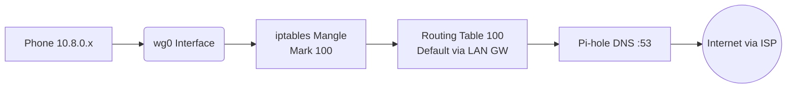
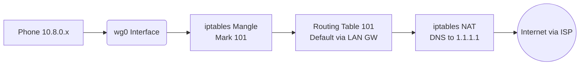
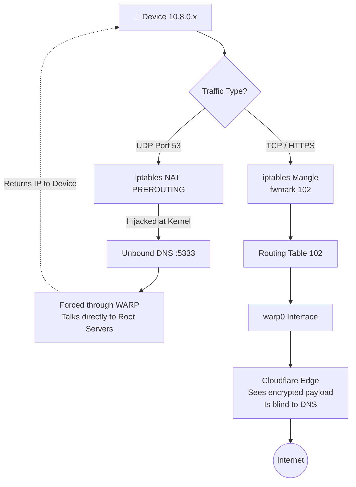
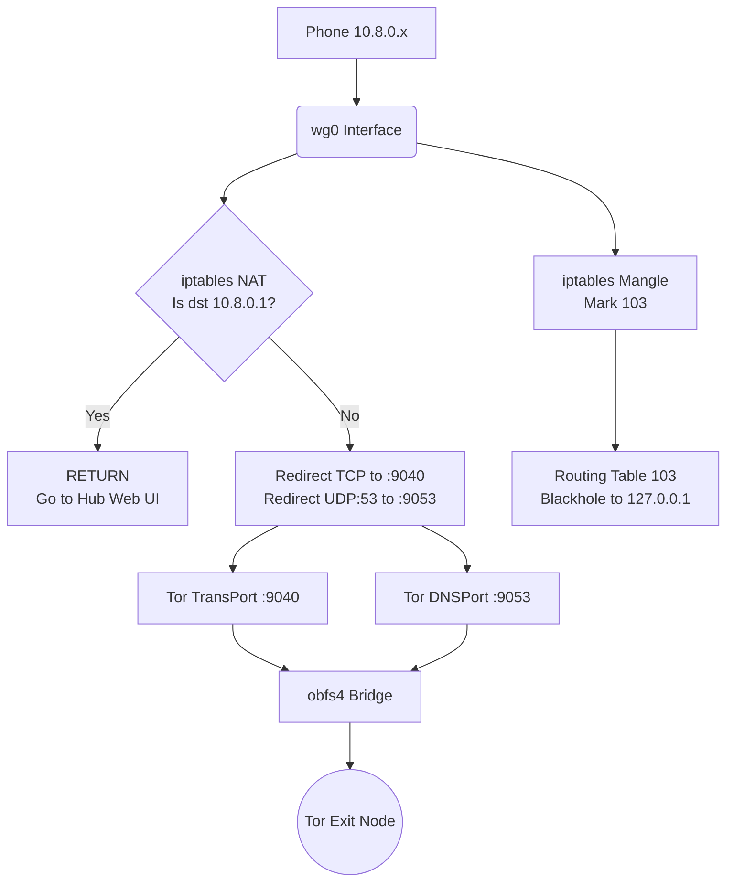
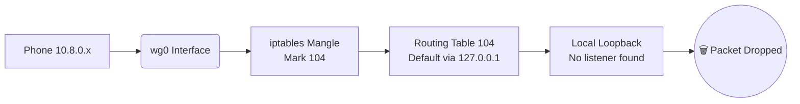

# The 5 Per-Device Routing Modes

## 1. `no_ads` Mode (Pi-hole DNS)

## 2. `vpn_only` Mode (Direct Internet + Cloudflare DNS)

*Note: This mode bypasses Pi-hole to prevent ad-blocking from interfering with strict app connections.*

## 3. `full_privacy` Mode (Split-Trust: WARP Payload + Unbound DNS)

> [!tip] The "Zero-Trust" DNS Architecture
> Notice that DNS (UDP 53) goes straight to Unbound. Unbound then talks directly to root nameservers, but its outbound traffic is forced through the WARP tunnel via `fwmark 102` on the `OUTPUT` chain. This ensures Cloudflare only sees encrypted IPs, while your ISP sees nothing but the WARP tunnel.

## 4. `fully_hidden` Mode (Transparent Tor)

> [!tip] The 10.8.0.1 Exception
> Notice the `RETURN` rule for `10.8.0.1` in Fully Hidden mode. Without this, when a remote user tries to load the Privacy Hub web UI, the NAT rule would try to redirect port 5000 traffic to Tor, breaking the dashboard. This rule ensures local management traffic bypasses the Tor proxy.

## 5. `panic` Mode (Virtual Air-Gap)

### Technical Execution
When triggered, the system performs a surgical, stateful teardown and rebuild of the device's network routing at Linux kernel speed:
*   **The Purge:** `clear_device_rules()` surgically deletes *only* the `iptables` mangle marks, `ip rule` entries, and NAT redirects associated with that specific IP. Other devices are unaffected.
*   **The Blackhole:** The engine applies a new mangle mark (`--set-mark 104`) to all traffic from the target IP, binding it to Linux Routing Table 104. This table routes *everything* to the local loopback interface (`127.0.0.1`). Because no services are listening for this specific traffic on the loopback, the kernel silently drops the packets.
